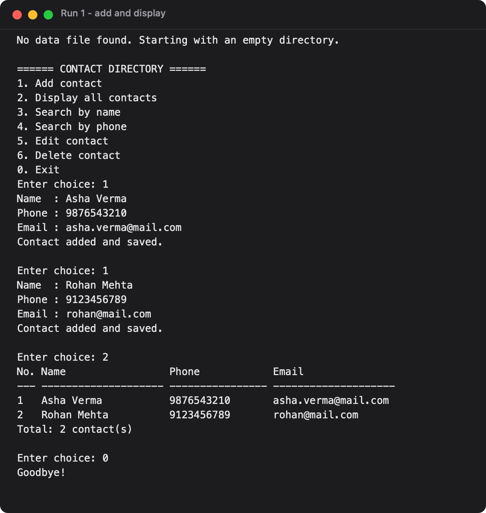
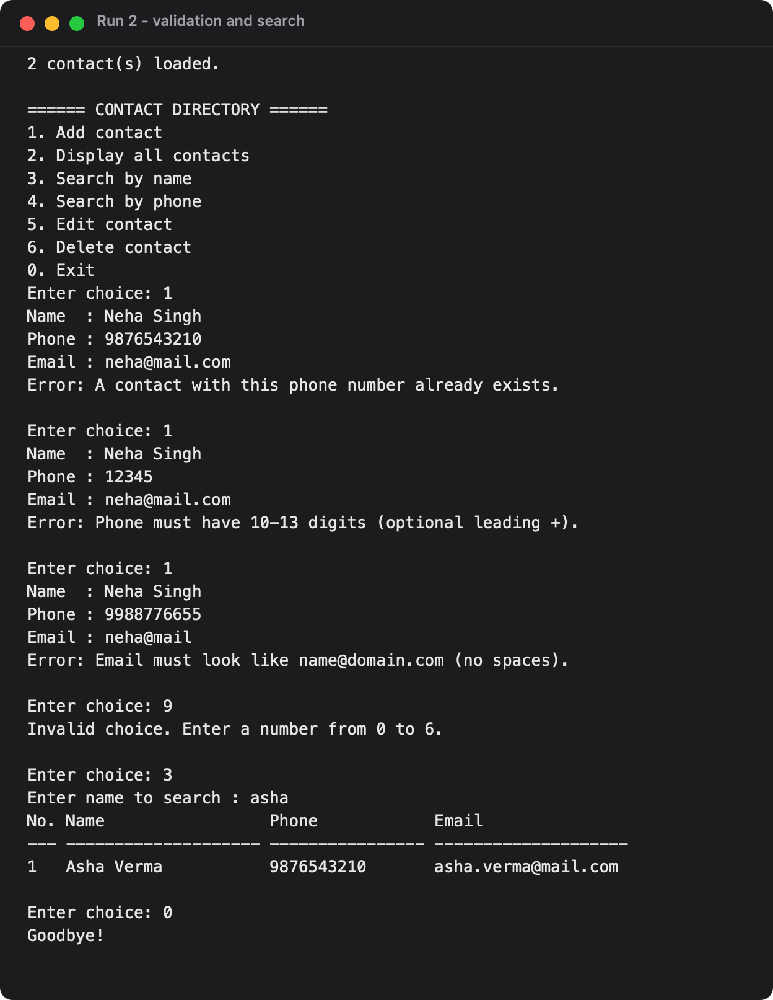
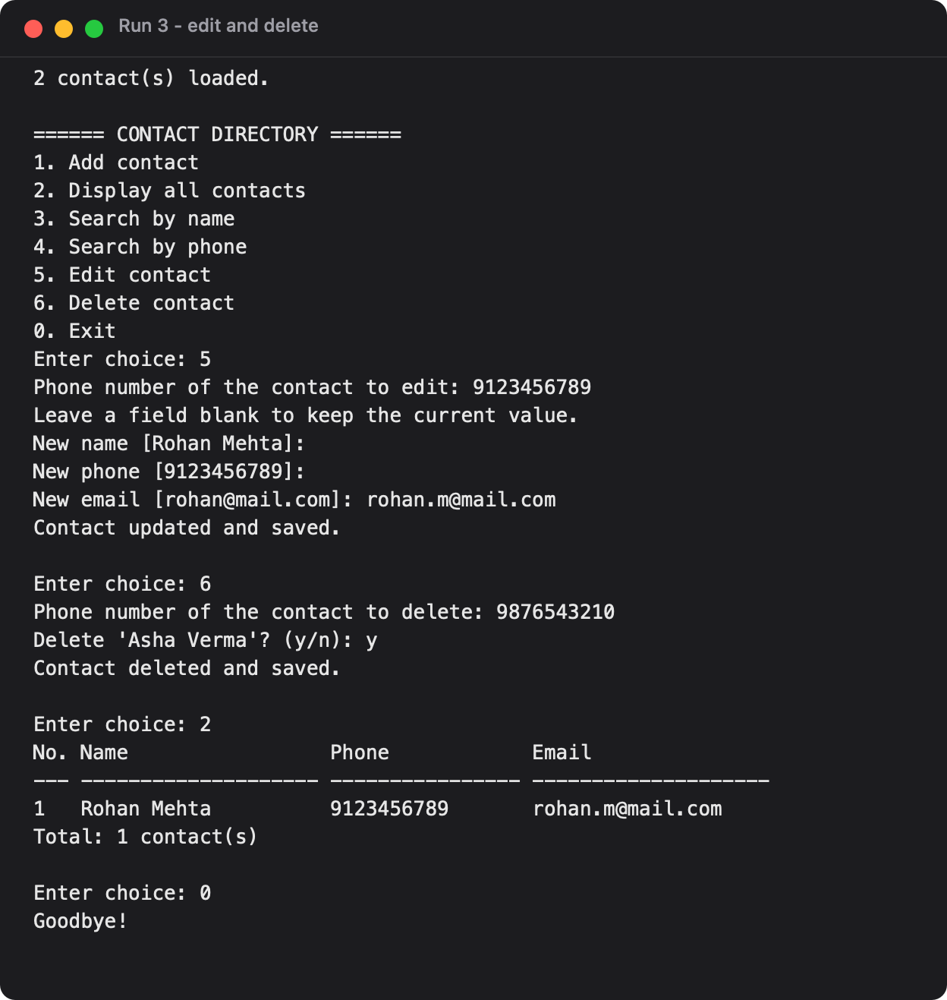

# 📇 File-Based Contact Directory (C++)

A menu-driven, console-based Contact Directory written in C++11 that stores contacts permanently on disk. Built as a mini project for **CIC-211: Object-Oriented Programming using C++**.

---

##  Overview

Managing contacts on paper or in scattered notes is slow and error-prone. This project stores each contact's name, phone number and email in a text file, reloads it at startup, and validates every input, so your data is still there the next time you run the program.

##  Features

- Menu-driven interface: Add, Display all, Search by name, Search by phone, Edit, Delete, Exit
- Phone number is the unique key (duplicates are rejected on add and on edit)
- Input validation:
  - Name must not be empty
  - Phone must have 10-13 digits (optional leading `+`)
  - Email must look like `name@domain.com`
- Partial, case-insensitive name search; contacts are displayed alphabetically
- Every change is saved immediately to the file
- A missing or partly corrupt data file does not crash the program
- Edit works on a copy, so a failed edit never leaves a half-updated contact

##  OOP Concepts Used

| Concept | Where implemented |
|---|---|
| Classes and objects | `Contact`, `ContactDirectory` |
| Encapsulation | Private members accessed only through getters and validating setters |
| Constructors | `Contact(name, phone, email)`, `ContactDirectory(file)` |
| Strings and streams | `ifstream` / `ofstream` in `load()` and `save()`; `stringstream` in `fromFileLine()` |
| Vectors and iterators | `vector<Contact>`; `find_if`, `sort` and iterator loops in search, display and delete |
| Exception handling | `invalid_argument` for bad input, `runtime_error` for file problems; caught in `main()` |

##  Class Design

| Class | Private data | Key public functions |
|---|---|---|
| `Contact` | name, phone, email | constructors, getters, validating setters, `toFileLine()`, `fromFileLine()`, `display()` |
| `ContactDirectory` | filename, `vector<Contact> contacts` | `load()`, `addContact()`, `displayAll()`, `search()`, `editContact()`, `deleteContact()` (private: `save()`, `findByPhone()`) |

**File format:** one contact per line as `name|phone|email`

##  Tech Stack

- C++11 (standard library only)
- STL: `vector`, `algorithm`, iterators
- `fstream`, `sstream`
- g++ compiler; VS Code / Code::Blocks
- Runs on Windows, Linux and macOS

##  How to Run

```bash
git clone https://github.com/anushkasuri439-afk/Contact-directory.git
cd Contact-directory
g++ -std=c++11 contact_directory.cpp -o contact_directory
./contact_directory
```

> On Windows, run `contact_directory.exe`. The data file (`contacts.txt`) is created automatically on the first save.

##  Sample Output

```
===== CONTACT DIRECTORY =====
1. Add contact
2. Display all contacts
3. Search by name
4. Search by phone
5. Edit contact
6. Delete contact
0. Exit
Enter choice: 1
Name  : Asha Verma
Phone : 9876543210
Email : asha.verma@mail.com
Contact added and saved.

Enter choice: 2
No. Name                 Phone          Email
---------------------------------------------------------------
1   Asha Verma           9876543210     asha.verma@mail.com
Total: 1 contact(s)
```

### Output Screenshots

**Fig. 1: Add two contacts and display them**



**Fig. 2: Restart (2 contacts loaded), validation errors, search**



**Fig. 3: Restart, edit email, delete a contact**



##  Testing

All 13 test cases passed:

| # | Test input | Expected result | Status |
|---|---|---|---|
| 1 | Add Asha Verma, 9876543210 | Added and saved | Pass |
| 2 | Add contact with an existing phone | Error: already exists | Pass |
| 3 | Phone `12345` (boundary/invalid) | Error: 10-13 digits | Pass |
| 4 | Email `neha@mail` | Error: invalid email | Pass |
| 5 | Menu choice 9 | Invalid choice message | Pass |
| 6 | Search name `asha` | Asha Verma shown | Pass |
| 7 | Edit email only (blank = keep) | Only email changes | Pass |
| 8 | Delete contact, answer `y` | Removed, file updated | Pass |
| 9 | Run with no `contacts.txt` | Starts with empty list | Pass |
| 10 | Data file has a broken line (e.g. `Asha\|123`) | Line skipped, other contacts load | Pass |
| 11 | Search by phone `9876543210` | Asha Verma shown | Pass |
| 12 | Edit phone to one that already exists | Error: already exists; contact unchanged | Pass |
| 13 | Delete contact, answer `n` | Contact kept, file unchanged | Pass |

Data saved in one run is correctly reloaded in the next, and invalid input never crashes the program.

##  Future Scope

- Database or encrypted data file
- Extra fields (address, birthday, groups)
- CSV import/export
- Simple GUI

**Limitations:** the whole file is rewritten on each change, and only one phone number is stored per contact.

##  Mapped SDGs

- **SDG 9**: Industry, Innovation and Infrastructure (building reliable digital tools)
- **SDG 4**: Quality Education (hands-on learning of programming)


